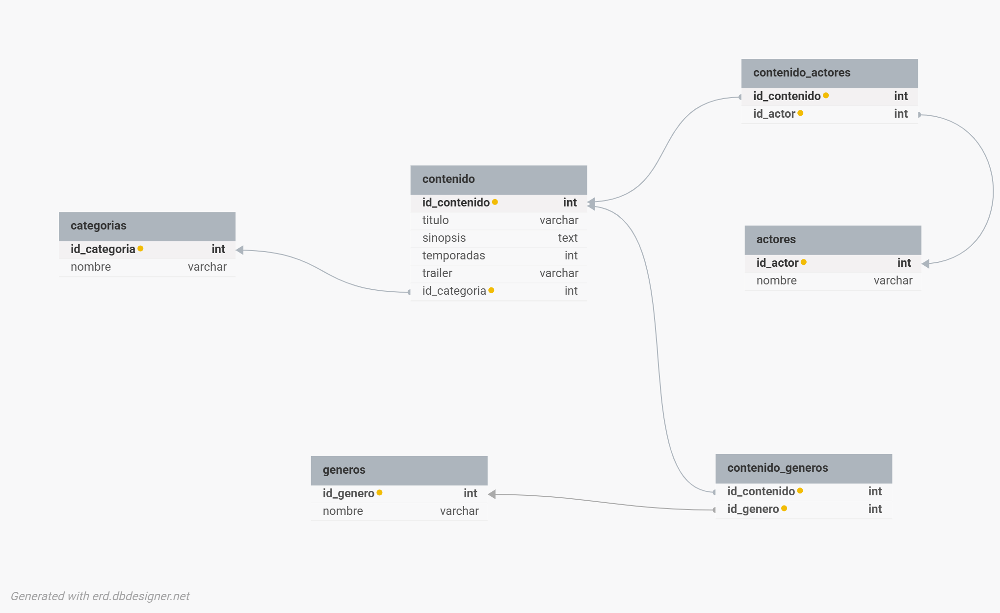

# 🎬 API de Trailerflix

Una API RESTful desarrollada con **Node.js**, **Express**, **Sequelize** y **MySQL**, que permite consultar, filtrar, crear, editar y eliminar películas y series de un catálogo audiovisual normalizado.

---

## 🛠️ Tecnologías utilizadas

* [Node.js](https://nodejs.org) - entorno de ejecución JavaScript
* [Express](https://expressjs.com) - framework web para Node
* [Sequelize](https://sequelize.org) - ORM para bases de datos SQL
* [MySQL](https://mysql.com) - sistema de gestión de bases de datos relacionales
* [MySQL Workbench](https://mysql.comproducts/workbench/) - herramienta gráfica para administrar y exportar la base de datos
* [DB Designer](https://dbdesigner.net) - herramienta de modelado Entidad-Relación
* [dotenv](https://npmjs.com) - manejo de variables de entorno

---

## 📁 Estructura del proyecto

```text
trailerflix-api/
├── database/
│   ├── trailerflix.png         # Diagrama Entidad-Relación (DB Designer)
│   └── trailerflix.sql         # Script SQL con estructura y datos cargados
├── src/
│   ├── config/
│   │   └── database.js         # Conexión a MySQL con Sequelize
│   ├── models/
│   │   ├── Actor.js            # Modelo tabla actores
│   │   ├── Categoria.js        # Modelo tabla categorias
│   │   ├── Contenido.js        # Modelo tabla contenido
│   │   ├── Genero.js           # Modelo tabla generos
│   │   └── index.js            # Relaciones 1:N y N:M
│   ├── routes/
│   │   └── catalogoRoutes.js   # Rutas CRUD y filtros con parámetros
│   ├── seed/
│   │   └── migrar.js           # Script de migración desde trailerflix.json
│   └── app.js                  # Servidor Express
├── .env                        # Variables de entorno (no subir a GitHub)
├── .env.example                # Plantilla de variables de entorno
├── .gitignore                  # Archivos ignorados por Git
├── package.json                # Dependencias y scripts del proyecto
├── trailerflix.json            # Dataset original (30 producciones)
└── README.md                   # Documentación
```

---

## 🗄️ Diseño del Modelo Relacional

Partiendo del archivo plano `trailerflix.json`, se normalizaron los datos hacia una base de datos relacional llamada **`trailerflix`** compuesta por **6 tablas** en Tercera Forma Normal (3FN):

* **`categorias` (1:N):** Separa las categorías únicas (`Serie`, `Película`).
* **`contenido`:** Tabla central con título, sinopsis, temporadas (`INT NULL`) y tráiler (`VARCHAR NULL`).
* **`generos` y `actores`:** Catálogos únicos sin nombres duplicados.
* **`contenido_generos` y `contenido_actores` (N:M):** Tablas intermedias que resuelven las relaciones de muchos a muchos.



---

## ⚙️ Configuración inicial

1. **Cloná este repositorio** (o descomprimí el proyecto).
2. **Asegurate de tener MySQL corriendo** y creá la base de datos vacía:
   ```sql
   CREATE DATABASE trailerflix CHARACTER SET utf8mb4 COLLATE utf8mb4_unicode_ci;
   ```
3. **Creá un archivo `.env` en la raíz del proyecto** tomando como guía `.env.example`:
   ```env
   PORT=3008
   DB_HOST=localhost
   DB_USER=root
   DB_PASSWORD=tu_contraseña
   DB_NAME=trailerflix
   ```
4. **Instalá las dependencias:**
   ```bash
   npm install
   ```
5. **Migrá los datos del JSON a MySQL** (crea las 6 tablas y carga los 30 registros):
   ```bash
   npm run migrar
   ```
6. **Iniciá el servidor:**
   ```bash
   npm start
   ```

---

## 📡 Endpoints disponibles

| Método | Ruta | Descripción |
| :--- | :--- | :--- |
| `GET` | `/catalogo` | Trae todas las películas y series con categoría, géneros y reparto |
| `GET` | `/titulo/:title` | Busca producciones por coincidencia parcial en el título |
| `GET` | `/categoria/:cat` | Filtra el catálogo por categoría (`Serie` o `Película`) |
| `GET` | `/reparto/:act` | Trae las producciones donde participa un actor o actriz |
| `GET` | `/trailer/:id` | Trae el enlace del tráiler de un contenido por su ID |
| `POST` | `/catalogo` | Crea una nueva película o serie con sus relaciones |
| `PUT` | `/catalogo/:id` | Actualiza un contenido existente por su ID |
| `DELETE` | `/catalogo/:id` | Elimina un contenido por su ID y limpia sus tablas intermedias |

---

### 💡 Ejemplo de petición `POST /catalogo`

**URL:** `http://localhost:3008/catalogo`

**Body (JSON):**
```json
{
  "id_contenido": 31,
  "titulo": "El Eternauta",
  "categoria": "Serie",
  "generos": ["Ciencia Ficción", "Drama"],
  "sinopsis": "Tras una nevada mortal en Buenos Aires, un grupo de sobrevivientes lucha contra una amenaza alienígena.",
  "temporadas": 1,
  "reparto": ["Ricardo Darín", "Carla Peterson"],
  "trailer": "https://youtube.com"
}
```

---

## 🎓 Créditos y propósito

* Proyecto educativo desarrollado para la diplomatura/curso de Desarrollo Backend con Node.js, Express, Sequelize y MySQL.
* Inspirado en la arquitectura y buenas prácticas trabajadas en clase con la profesora Tatiana Borda.
*